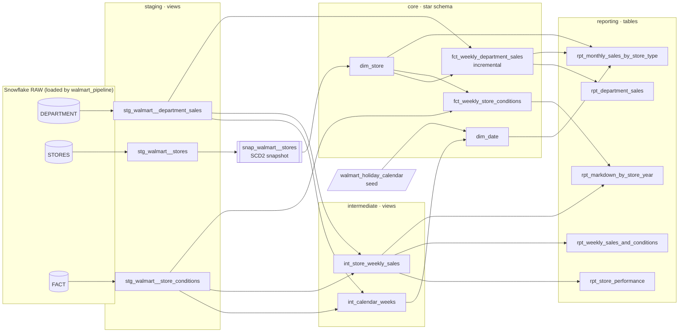

# Walmart Sales: dbt + Snowflake

A dbt project that turns the raw Walmart sales data into a tested star schema with
SCD Type 2 store history, plus five report tables behind a 10-report sales dashboard.

It's the dbt version of [walmart_pipeline](https://github.com/glowwormkpo/walmart_pipeline).
That repo lands the three CSVs in S3 and loads them into `WALMART_E2E.RAW`. Its
transformations were hand-written SQL scripts run in order. This project replaces those
scripts with version-controlled dbt models, so dependencies, tests and documentation are
managed together.

**Stack:** Snowflake · dbt Core 1.12 · Git/GitHub  
**Data:** 421,570 store-department-week sales rows · 45 stores · 8,190 store-week condition rows (Feb 2010 to Jul 2013)

## Lineage



Run `dbt docs generate && dbt docs serve` to browse the full interactive lineage graph
and column-level documentation.

## Models

| Layer | Model | Grain | Materialization |
|---|---|---|---|
| Staging | `stg_walmart__department_sales` | store · dept · week | view |
| Staging | `stg_walmart__stores` | store | view |
| Staging | `stg_walmart__store_conditions` | store · week | view |
| Snapshot | `snap_walmart__stores` | store version | snapshot (check strategy) |
| Intermediate | `int_calendar_weeks` | week | view |
| Intermediate | `int_store_weekly_sales` | store · week | view |
| Core | `dim_date` | week | table |
| Core | `dim_store` | store version (SCD2) | table |
| Core | `fct_weekly_department_sales` | store · dept · week | incremental (merge) |
| Core | `fct_weekly_store_conditions` | store · week | table |
| Reporting | `rpt_department_sales` | dept | table |
| Reporting | `rpt_monthly_sales_by_store_type` | month · store type | table |
| Reporting | `rpt_store_performance` | store | table |
| Reporting | `rpt_weekly_sales_and_conditions` | week | table |
| Reporting | `rpt_markdown_by_store_year` | store · year | table |

The five reporting tables cover all 10 dashboard reports. The `walmart_sales_dashboard`
exposure links them to the Streamlit app, so `dbt ls --select +exposure:walmart_sales_dashboard`
shows everything the dashboard depends on.

## Design decisions

**1. Store history is a dbt snapshot, at the store grain.**
The original pipeline maintained SCD2 with a hand-written expire-then-insert MERGE at the
store + department grain (3,331 rows). Store type and size describe the store, not the
department, so that grain repeated each store's attributes about 74 times on average. Here
`snap_walmart__stores` tracks 45 stores with dbt's `check` strategy on
`store_type` and `store_size_sqft`.

**2. Facts join to the store version that was in effect that week.**
A snapshot stamps each store's first version with the date it was first captured, which
is years after the sales happened. The original pipeline worked around this by joining
on `IS_CURRENT = TRUE`, which silently re-labels history with today's attributes once a
store changes. `dim_store` instead backdates each store's first version to 1900-01-01,
and the facts use a point-in-time join (`week_date >= valid_from and < valid_to`).
Resize a store today, and its 2010–2012 sales keep the size it had then.
`analyses/simulate_store_change.sql` walks through the demo.

**3. Store-level measures never sit on department rows.**
Markdowns, CPI, fuel price and temperature are recorded once per store-week. The original
dashboard summed `MARKDOWN1 + … + MARKDOWN5` over the department-grain fact table. That
counted each store's markdown once per department. It also returned null for any week
where one of the five columns was null, because adding a null gives null. Here those
measures live in their own fact (`fct_weekly_store_conditions`). Any report that mixes
them with sales goes through `int_store_weekly_sales`, which rolls sales up to
store-week *before* joining.

**4. The sales fact is incremental.**
After the first build, each run re-processes only the trailing 4 weeks (the
`incremental_lookback_weeks` var) and merges them on `store_id + dept_id + date_id`. New
weeks are appended, and late corrections to recent weeks overwrite the old values
instead of creating duplicates. Rebuild everything with `dbt build --full-refresh`.

**5. No package dependencies.**
The two generic tests the project needs (`unique_combination_of_columns`,
`accepted_range`) are written in `tests/generic/`, so the project runs without `dbt deps`.

## Tests

Over 70 data tests run on every `dbt build`:

- **Grain:** every model has a uniqueness test on its grain columns.
- **Keys:** `not_null` and `relationships` tests from both facts to `dim_date` and `dim_store`.
- **Values:** accepted values for store type, and ranges for store size, temperature and unemployment.
- **`assert_fact_reconciles_to_source`:** the fact's row count and total sales must exactly
  match `RAW.DEPARTMENT`. That proves no join dropped or duplicated rows.
- **`assert_store_versions_do_not_overlap`:** each store has exactly one current version and
  no overlapping date ranges. Overlaps would duplicate sales in the point-in-time join.
- **`assert_holiday_flags_agree`** (warn): the IsHoliday flags in `department.csv` and
  `fact.csv` must agree with each other and with the holiday calendar seed.

## Running it

**Prerequisites:** the raw tables from `walmart_pipeline` in `WALMART_E2E.RAW`.

```sql
SELECT 'DEPARTMENT', COUNT(*) FROM WALMART_E2E.RAW.DEPARTMENT   -- 421,570
UNION ALL SELECT 'STORES', COUNT(*) FROM WALMART_E2E.RAW.STORES -- 45
UNION ALL SELECT 'FACT', COUNT(*) FROM WALMART_E2E.RAW.FACT;    -- 8,190
```

**Setup:**

```bash
python3 -m venv .venv && source .venv/bin/activate
pip install "dbt-core~=1.12" "dbt-snowflake~=1.12"

mkdir -p ~/.dbt && cp profiles.example.yml ~/.dbt/profiles.yml
export SNOWFLAKE_ACCOUNT=<account identifier>
export SNOWFLAKE_USER=<user>
export SNOWFLAKE_PASSWORD=<password>

dbt debug          # checks the connection
dbt build          # seed, snapshot, models and tests, in dependency order
dbt docs generate && dbt docs serve
```

Dev builds land in `DBT_DEV_STAGING`, `DBT_DEV_CORE` and so on. `dbt build --target prod`
builds clean `STAGING`, `CORE` and `REPORTING` schemas (see `macros/generate_schema_name.sql`).

The models use one adapter-dispatched macro (`date_to_id`), so the same project also
builds on DuckDB. That's how it was tested locally before running on Snowflake.
